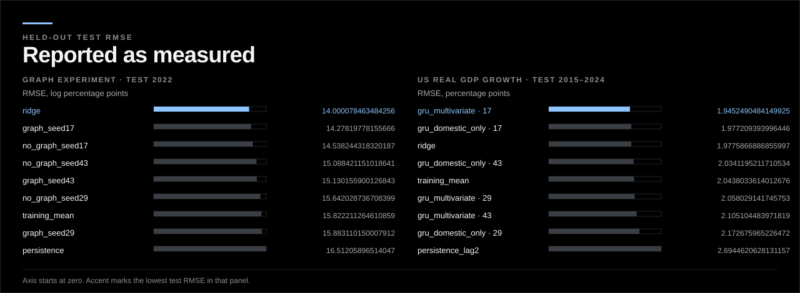
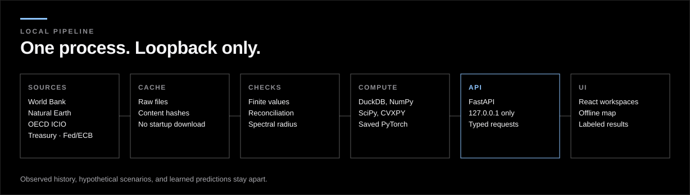

# ATLAS

**A local research terminal that traces a cost shock through observed production networks, and prints the forecasts that lost.**

**[Case study](https://shmorsi.github.io/projects/atlas.html)** · [Portfolio](https://shmorsi.github.io/) · [Release v0.1.2](https://github.com/shmorsi/atlas/releases/tag/v0.1.2) · [Research report](docs/RESEARCH_REPORT.md) · [Model card](docs/MODEL_CARD.md)

[](https://github.com/shmorsi/atlas/actions/workflows/validate.yml)
[](https://github.com/shmorsi/atlas/actions/workflows/docker.yml)
[](https://github.com/shmorsi/atlas/releases/tag/v0.1.2)
[](LICENSE)



## Key results

- **Graph experiment, 2022 held out (405 nodes).** Ridge has the lowest test RMSE, `14.000078463484256`. The graph model does not beat its zero-edge ablation on every seed.
- **US real GDP growth, 2015–2024 held out.** Ridge test RMSE is `1.9775866886855997`. Two GRU runs are below it: multivariate seed 17 (`1.9452490484149925`) and domestic-only seed 17 (`1.977209393996446`). The other four are not. Seed 17 was the default before the test was inspected.
- **Fast and checkable.** A warm 405-node scenario takes a median `11.0` ms on one machine, and the release gate replays the saved checkpoints instead of trusting a stored metric.

**Caveat:** one held-out network year and ten annual GDP targets are feasibility checks. No generalization, calibration or causal claim follows. Every figure here is the exact token from a committed JSON file; the tables are under [Full results](#full-results).

## How it works



One loopback FastAPI process serves hashed, cached World Bank, OECD and Treasury data, hypothetical input-output scenarios and saved PyTorch checkpoints to a React front end. Country exploration, the OECD network, Scenario Studio, rates, portfolios, forecasting and official events are separate workspaces. Observed history, hypothetical effects, bond valuations and learned predictions stay labeled apart. Scenarios are labeled hypothetical, and every seed is reported, including the ones that lose to ridge.


<details>
<summary><b>More screenshots</b></summary>


The rest of the inspected layouts are in [`docs/SCREENSHOTS.md`](docs/SCREENSHOTS.md).

</details>

## Quick start

No authentication. The app listens on loopback only.

```sh
npm ci
npm run setup
npm run atlas
```

Open http://127.0.0.1:8000. Needs Node 22+ and Python 3.12–3.13. Install needs a network; startup does not. Docker, Windows paths, the Linux CPU PyTorch wheel and hot reload are in the [development guide](docs/DEVELOPMENT.md).

## Repository map

| Path | What it is |
|---|---|
| `backend/atlas/` | FastAPI app: data access, input-output network and Scenario Studio, Treasury curves, finance, GRU and graph forecasters |
| `backend/tests/` | Backend tests, including the check that this README quotes the committed JSON exactly |
| `frontend/src/` | React workspaces, map, charts and the guided experience |
| `scripts/` | Setup and start, data preparation, training, the release gate (`check_release.py`) and README figure rendering |
| `data/` | Hashed manifests, processed caches and saved checkpoints with their evaluation JSON |
| `tests/` | Playwright UI suite and visual baselines |
| `learning/`, `notebooks/` | Fifteen study notes and three notebooks behind the methods |

## Documents

| Document | What it is |
|---|---|
| [docs/RESEARCH_REPORT.md](docs/RESEARCH_REPORT.md) | Data, method and every evaluation |
| [docs/MODEL_CARD.md](docs/MODEL_CARD.md) | Intended use and limits of the saved models |
| [docs/VALIDATION.md](docs/VALIDATION.md) | Executed checks and browser evidence |
| [docs/BUILD_STATUS.md](docs/BUILD_STATUS.md) | What is implemented, with the recorded data counts |
| [docs/SCENARIO_STUDIO.md](docs/SCENARIO_STUDIO.md) · [docs/SCENARIO_STUDIO_RESEARCH.md](docs/SCENARIO_STUDIO_RESEARCH.md) | Scenario Studio design and its research basis |
| [docs/API.md](docs/API.md) | Loopback API reference |
| [docs/DATA_SOURCES.md](docs/DATA_SOURCES.md) · [docs/OECD_IMPORT.md](docs/OECD_IMPORT.md) | Sources, licences and the OECD import |
| [docs/DEVELOPMENT.md](docs/DEVELOPMENT.md) · [docs/RELEASE.md](docs/RELEASE.md) | Development guide and release notes |
| [learning/README.md](learning/README.md) | Study notes on the mathematics and engineering |
| [SECURITY.md](SECURITY.md) | The loopback security boundary |

## Full results

Every figure is copied from a committed file; nothing is rounded, interpolated or estimated. [`docs/RESEARCH_REPORT.md`](docs/RESEARCH_REPORT.md) prints the same evaluations to four decimal places, and [`scripts/render_readme_figures.py`](scripts/render_readme_figures.py) draws the chart from the same tokens.

<details>
<summary><b>Graph experiment, one held-out year (2022)</b></summary>

Target is the next annual log change in country-sector gross output. Train 2018–2020, validation 2021, test 2022, 405 dependent nodes, 81 parameters. Source: [`data/models/gnn/evaluation.json`](data/models/gnn/evaluation.json).

| Model | Test RMSE | Test MAE |
|---|---:|---:|
| ridge | 14.000078463484256 | 9.397344422846155 |
| graph_seed17 | 14.27819778155666 | 9.484987390823374 |
| no_graph_seed17 | 14.538244318320187 | 9.625492874314386 |
| no_graph_seed43 | 15.088421151018641 | 10.199939650553098 |
| graph_seed43 | 15.130155900126843 | 10.239191931405065 |
| no_graph_seed29 | 15.642028736708399 | 10.68678092914435 |
| training_mean | 15.822211264610859 | 10.734963018075211 |
| graph_seed29 | 15.883110150007912 | 10.901140053208215 |
| persistence | 16.51205896514047 | 11.830011849722426 |

</details>

<details>
<summary><b>US real GDP growth, ten held-out years (2015–2024)</b></summary>

Inputs end at t−2. 354 parameters with all features, 282 in the domestic-only ablation. Seeds 17, 29, and 43 are all reported. Source: [`data/models/evaluation.json`](data/models/evaluation.json).

| Model | Seed | Test RMSE | Test MAE | Nominal 80% coverage |
|---|---:|---:|---:|---:|
| gru_multivariate | 17 | 1.9452490484149925 | 1.1803315213484535 | 0.8 |
| gru_domestic_only | 17 | 1.977209393996446 | 1.2015100466519733 | 0.8 |
| ridge | — | 1.9775866886855997 | 1.3090976214639525 | — |
| gru_domestic_only | 43 | 2.0341195211710534 | 1.3685062222090554 | 0.8 |
| training_mean | — | 2.0438033614012676 | 1.3626015214125236 | — |
| gru_multivariate | 29 | 2.058029141745753 | 1.3959041102776653 | 0.8 |
| gru_multivariate | 43 | 2.105104483971819 | 1.4981929916077439 | 0.7 |
| gru_domestic_only | 29 | 2.172675965226472 | 1.6165172531367997 | 0.8 |
| persistence_lag2 | — | 2.6944620628131157 | 2.000157404319797 | — |

</details>

<details>
<summary><b>Warm loopback latency</b></summary>

One macOS ARM64 machine, ten sequential requests each, not a load test. Source: [`docs/LOCAL_LATENCY.json`](docs/LOCAL_LATENCY.json).

| Endpoint | Median ms | Max ms |
|---|---:|---:|
| `/api/network/country/JPN?year=2022` | 5.31 | 6.09 |
| `/api/countries?year=2025` | 6.47 | 12.42 |
| `/api/network/scenario` | 11.0 | 11.77 |
| `/api/forecast/replay` | 40.51 | 59.4 |

</details>

The bundled atlas also holds 177 Natural Earth geometries, 42,900 frozen 1960–2024 World Bank rows, a separate 2025 cache of 660 rows (592 nonmissing), seven OECD tables aggregated to 405 nodes across 81 areas, 694 observed Treasury par curves through 2026-10-09, and 30 dated Fed/ECB releases. Those counts are recorded in [`docs/BUILD_STATUS.md`](docs/BUILD_STATUS.md) and [`docs/RESEARCH_REPORT.md`](docs/RESEARCH_REPORT.md).

## Limitations

- Beyond the caveat under Key results: the 405 nodes in the held-out network year are dependent, and the GRU's nominal 80% intervals are not recalibrated.
- World Bank rows are revised history. There is no release vintage, so this is not a point-in-time backtest.
- Scenarios use fixed historical coefficients and one pass-through rate. They are not GDP, inflation, or an asset return.
- Warm latency figures are ten sequential loopback requests on one macOS ARM64 machine. Not a load test, a cold start, or a promise for other hardware.
- Browser evidence is local Chromium. Safari, Firefox, and a human accessibility pass are not done.
- Loopback, single user. An internet-facing deployment would need authentication, a security review, and monitoring that this release does not include.

## What I'd do next

Not built. Not a result.

- A language-agent research assistant on top of this terminal. It would call the local API, cite the cached source behind each number, and refuse a figure that those responses do not contain.
- Release-vintage World Bank series, so a forecast can be checked at publication time. The current rows are revised history.
- More than one held-out network year before asking whether the graph helps. Three training years and one test year are a feasibility check.
- Firefox, Safari, and a human accessibility pass. The automated UI suite is Chromium.

## Reproducibility and integrity

- `requirements-lock.txt` and `package-lock.json` pin the dependency sets. On Linux, setup installs the CPU PyTorch wheel before the rest of the lock.
- There is no separate pre-registration file. The splits, seeds, and baselines are the records in the evaluation JSON. `npm run verify:release` replays 60 held-out GRU means and intervals and 2,430 graph node predictions from the saved checkpoints (`scripts/check_release.py`) instead of trusting a retyped metric.
- Evaluation files, hashes, manifests, caches, checkpoints, `docs/LOCAL_LATENCY.json`, and `docs/ICIO_SAMPLE_AUDIT.json` are records. Do not edit them by hand. The key-result figures in this file are the exact JSON tokens; `backend/tests/test_readme_figures.py` fails if they drift. The same test fails if `docs/figures/` drifts from [`scripts/render_readme_figures.py`](scripts/render_readme_figures.py).
- `docs/screenshots/` was captured from the running app on Linux Chromium. Playwright also wrote `*-linux.png` baselines with `npx playwright test --update-snapshots`. The `*-darwin.png` files are the previous interface; refresh them on a Mac with that same command before trusting a macOS pixel run. The command is in the [development guide](docs/DEVELOPMENT.md).
- The validate workflow runs setup, Ruff, backend tests, the release gate, and the production build on Ubuntu, macOS, and Windows, for Python 3.12 and 3.13. The Docker image stays on 3.12. Browser evidence in [`docs/VALIDATION.md`](docs/VALIDATION.md) is local Chromium. A short [model card](docs/MODEL_CARD.md) states intended use and limits without a second results table. [Security](SECURITY.md) records the loopback boundary.

## License and citation

MIT ([LICENSE](LICENSE)). Cite this software with [`CITATION.cff`](CITATION.cff). Third-party data are credited in [docs/DATA_SOURCES.md](docs/DATA_SOURCES.md).
