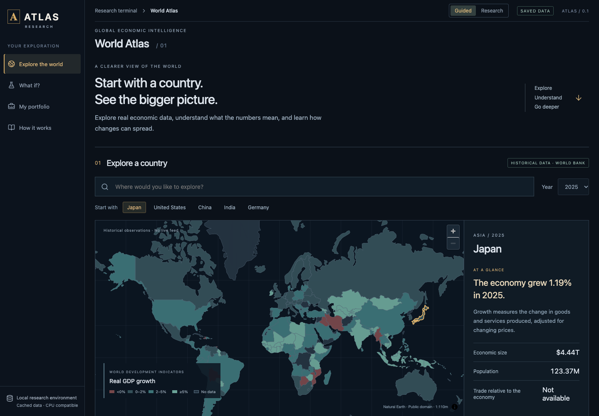
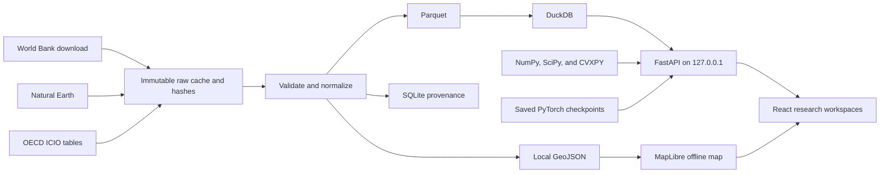
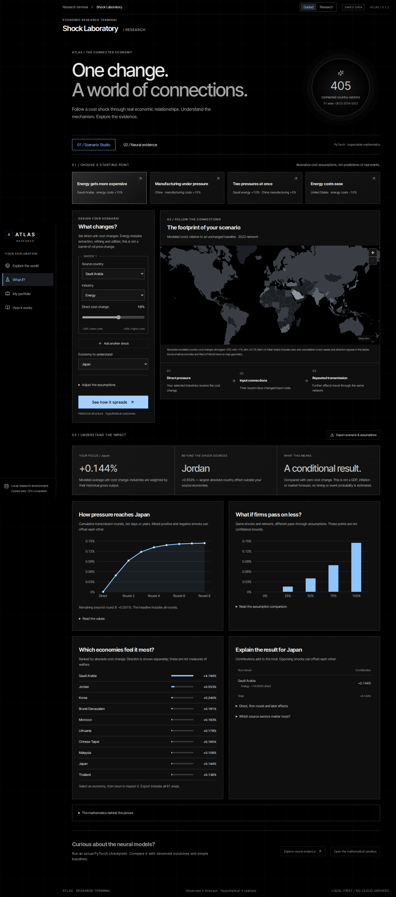

# ATLAS

**A local-first economic research terminal: cached country data, production-network scenarios, and reproducible PyTorch experiments in one offline app.**

[](https://github.com/shmorsi/atlas/actions/workflows/validate.yml)
[](https://github.com/shmorsi/atlas/actions/workflows/docker.yml)
[](https://github.com/shmorsi/atlas/releases/tag/v0.1.2)
[](LICENSE)

[Project page](https://shmorsi.github.io/projects/atlas.html) · [v0.1.2](https://github.com/shmorsi/atlas/releases/tag/v0.1.2) · [Research report](docs/RESEARCH_REPORT.md) · [Validation](docs/VALIDATION.md) · [API](docs/API.md)



## Key results

Figures below are copied from committed files. Nothing here is rounded, interpolated, or estimated. [`docs/RESEARCH_REPORT.md`](docs/RESEARCH_REPORT.md) prints the same evaluations to four decimal places; the JSON files are the source.

**Graph experiment, one held-out year (2022).** Target is the next annual log change in country-sector gross output. Train 2018–2020, validation 2021, test 2022, 405 dependent nodes, 81 parameters. Ridge has the lowest test RMSE. The graph does not beat the zero-edge ablation on every seed. Source: [`data/models/gnn/evaluation.json`](data/models/gnn/evaluation.json).

| Model | Test RMSE | Test MAE |
|---|---:|---:|
| ridge | 14.000078463484256 | 9.397344422846155 |
| graph_seed17 | 14.27819778155666 | 9.484987390823374 |
| no_graph_seed17 | 14.538244318320187 | 9.625492874314386 |
| no_graph_seed43 | 15.088421151018641 | 10.199939650553098 |
| graph_seed43 | 15.130155900126843 | 10.239191931405065 |
| no_graph_seed29 | 15.642028736708399 | 10.68678092914435 |
| training_mean | 15.822211264610859 | 10.734963018075211 |
| graph_seed29 | 15.883110150007912 | 10.901140053208215 |
| persistence | 16.51205896514047 | 11.830011849722426 |

**US real GDP growth, ten held-out years (2015–2024).** Inputs end at t−2. 354 parameters with all features, 282 in the domestic-only ablation. Seeds 17, 29, and 43 are all reported. Default seed 17 was chosen before test inspection. Multivariate seed 17 and domestic-only seed 17 have test RMSE below ridge; the other four GRU runs do not. The GRU does not beat ridge on every seed. Source: [`data/models/evaluation.json`](data/models/evaluation.json).

| Model | Seed | Test RMSE | Test MAE | Nominal 80% coverage |
|---|---:|---:|---:|---:|
| gru_multivariate | 17 | 1.9452490484149925 | 1.1803315213484535 | 0.8 |
| gru_domestic_only | 17 | 1.977209393996446 | 1.2015100466519733 | 0.8 |
| ridge | — | 1.9775866886855997 | 1.3090976214639525 | — |
| gru_domestic_only | 43 | 2.0341195211710534 | 1.3685062222090554 | 0.8 |
| training_mean | — | 2.0438033614012676 | 1.3626015214125236 | — |
| gru_multivariate | 29 | 2.058029141745753 | 1.3959041102776653 | 0.8 |
| gru_multivariate | 43 | 2.105104483971819 | 1.4981929916077439 | 0.7 |
| gru_domestic_only | 29 | 2.172675965226472 | 1.6165172531367997 | 0.8 |
| persistence_lag2 | — | 2.6944620628131157 | 2.000157404319797 | — |

**Warm loopback latency**, one macOS ARM64 machine, ten sequential requests each, not a load test. Source: [`docs/LOCAL_LATENCY.json`](docs/LOCAL_LATENCY.json).

| Endpoint | Median ms | Max ms |
|---|---:|---:|
| `/api/network/country/JPN?year=2022` | 5.31 | 6.09 |
| `/api/countries?year=2025` | 6.47 | 12.42 |
| `/api/network/scenario` | 11.0 | 11.77 |
| `/api/forecast/replay` | 40.51 | 59.4 |

The bundled atlas also holds 177 Natural Earth geometries, 42,900 frozen 1960–2024 World Bank rows, a separate 2025 cache of 660 rows (592 nonmissing), seven OECD tables aggregated to 405 nodes across 81 areas, 694 observed Treasury par curves through 2026-10-09, and 30 dated Fed/ECB releases. Those counts are recorded in [`docs/BUILD_STATUS.md`](docs/BUILD_STATUS.md) and [`docs/RESEARCH_REPORT.md`](docs/RESEARCH_REPORT.md).

## Why this matters

The evaluation is allowed to lose. A ridge baseline beats every saved graph and no-graph checkpoint on the only held-out network year. The forecast experiment keeps every seed, including the ones that do not beat ridge. Scenarios are labeled hypothetical. Revised World Bank history has no release vintages, so it is not a point-in-time backtest.

The engineering around that record is the rest of the project: one loopback FastAPI process, hashed inputs, typed requests, and a release gate that replays the saved checkpoints instead of trusting a stored metric. It is a local research instrument, not a hosted trading system.

## Architecture



Country exploration, the OECD network, Scenario Studio, rates, portfolios, forecasting, and official events are separate workspaces. Observed history, hypothetical input-output effects, bond valuations, and learned predictions stay labeled apart. Detail: [`docs/API.md`](docs/API.md), [`docs/SCENARIO_STUDIO.md`](docs/SCENARIO_STUDIO.md), [`docs/BUILD_STATUS.md`](docs/BUILD_STATUS.md).



## Quickstart

No authentication. The app listens on loopback only.

```sh
npm ci
npm run setup
npm run atlas
```

Open http://127.0.0.1:8000. Needs Node 22+ and Python 3.12–3.13. Install needs a network; startup does not. Docker, Windows paths, the Linux CPU PyTorch wheel, and hot reload are in the [development guide](docs/DEVELOPMENT.md).

## Reproducibility and integrity

- `requirements-lock.txt` and `package-lock.json` pin the dependency sets. On Linux, setup installs the CPU PyTorch wheel before the rest of the lock.
- `npm run verify:release` replays 60 held-out GRU means and intervals and 2,430 graph node predictions from the saved checkpoints. The check is `scripts/check_release.py`.
- Evaluation files, hashes, manifests, caches, checkpoints, `docs/LOCAL_LATENCY.json`, and `docs/ICIO_SAMPLE_AUDIT.json` are records. Do not edit them by hand.
- Screenshot baselines are macOS Chromium images. Other operating systems run the behavioral UI tests, skip the pixel compare, and do not rewrite `docs/screenshots/`.
- The validate workflow runs setup, Ruff, backend tests, the release gate, and the production build on Ubuntu, macOS, and Windows. Browser evidence in [`docs/VALIDATION.md`](docs/VALIDATION.md) is local Chromium.

Cite this software with [`CITATION.cff`](CITATION.cff).

## What I'd do next

Not built. Not a result.

- A language-agent research assistant on top of this terminal. It would call the local API, cite the cached source behind each number, and refuse a figure that those responses do not contain.
- Release-vintage World Bank series, so a forecast can be checked at publication time. The current rows are revised history.
- More than one held-out network year before asking whether the graph helps. Three training years and one test year are a feasibility check.
- Firefox, Safari, and a human accessibility pass. The automated UI suite is Chromium, and the workflow runs Python 3.12 only.

Further boundaries are already written down in [`docs/NEXT_STEPS.md`](docs/NEXT_STEPS.md) and [`docs/FINISHING_PLAN.md`](docs/FINISHING_PLAN.md).

## Read next

[Development](docs/DEVELOPMENT.md) · [Research report](docs/RESEARCH_REPORT.md) · [Learning notebooks](learning/README.md) · [Demo script](docs/DEMO_SCRIPT.md) · [Data sources](docs/DATA_SOURCES.md) · [Release notes](docs/RELEASE.md)
