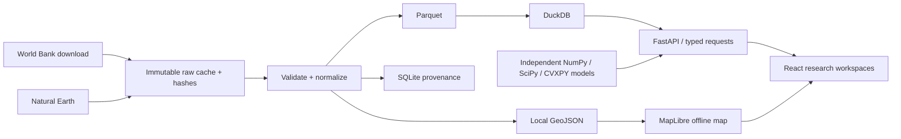

# ATLAS

Local-first global economic intelligence and quantitative research terminal. React + TypeScript + Vite + MapLibre + ECharts; Python + FastAPI + DuckDB/Parquet. No hosted services or credentials.

## Run

Prerequisites: Node 22+, Python 3.12–3.13, a modern WebGL2 browser. On Windows use Python from python.org and run in PowerShell; on macOS/Linux `python3` must refer to a supported Python. Tested on macOS ARM64 / Python 3.12.

```sh
npm install
npm run setup
npm run atlas
```

Open http://127.0.0.1:5173. API documentation: http://127.0.0.1:8000/docs. Stop with Ctrl+C. Installation needs internet; normal startup uses bundled data and no external service. The startup command binds only to loopback.

The supplied `.venv` and `node_modules` are local conveniences and not part of Git. Install your own dependencies after copying the project. `requirements-lock.txt` records this build's exact Python versions; `package-lock.json` pins JavaScript dependencies.

## Data

177 Natural Earth country/territory geometries and 42,900 WDI records (including missing values), covering GDP, population, growth and trade openness for 1960–2024. Each observation carries entity, unit, period, source, retrieval date, missingness flag and nullable publication/vintage fields. Original release dates are **unknown**. Revised history cannot substantiate a point-in-time backtest.

Natural Earth is public domain. WDI is attributed under World Bank CC BY 4.0 additional terms. See `data/manifest.json` and `docs/DATA_SOURCES.md`. Boundaries are generalized and depict de facto control; small territories may be absent. Country codes use Natural Earth's ADM0 identifiers, with World Bank codes cross-walked explicitly. Trade openness is not bilateral production exposure.

Refresh is explicit, never triggered on startup:

```sh
.venv/bin/python scripts/fetch_data.py
.venv/bin/python scripts/prepare_data.py
```

On Windows replace `.venv/bin/python` with `.venv/Scripts/python.exe`. Raw files are retained and hashed. Normalized observations use Parquet, queried through DuckDB. SQLite stores source metadata and is rebuilt by preparation.

## Checks

```sh
.venv/bin/python -m pytest -q
npm run build
npx playwright install chromium
npm run test:ui  # application must be running
```

See `docs/BUILD_STATUS.md` for exact completion boundaries and tests; `docs/screenshots/` for inspected layouts. Research workspaces are never filled with invented observations or fake model output.

## Architecture



## Navigation

Search countries by name/code, select by map or keyboard-accessible list, change common observation year, choose an indicator and region, and toggle globe/flat projection. Cmd/Ctrl+K focuses search. Escape clears search. Tables offer an accessible alternative to the map. Mobile stacks panels and scrolls wide comparison tables.

## Scientific contract

Observed history, hypothetical input-output effects, bond valuations, and learned predictions have separate result labels. No causal effect, investment performance, or neural improvement is implied without a measured evaluation. Unavailable data and unsupported model links remain explicit. This is research software, not an operational trading system.

## Working research modules

- **Shock / Network laboratories:** user-editable coefficient matrix; synthetic starting example explicitly labeled. Price and quantity solvers, decomposition and numerical diagnostics. No measured production network is currently loaded.
- **Rates:** hypothetical coupon-bond valuation, duration, convexity and exact yield-shift repricing.
- **Portfolio Studio:** locally uploaded total-return CSV, validated weights, volatility/drawdown/CVaR, minimum-variance/CVaR allocation and chronological holdout comparison. No redistributable market history is supplied.
- **Macro Forecasting:** real trained compact PyTorch GRU/Gaussian-head experiments, six saved checkpoints, three baselines, ablation, all seeds and held-out diagnostics. Small sample and revised-history limitations are explicit.
- **Historical Events:** observed annual GDP context around selected reference years, without causal attribution or point-in-time replay.

```sh
.venv/bin/python scripts/train.py
.venv/bin/python scripts/check_notebooks.py
```

See [technical research report](docs/RESEARCH_REPORT.md), [learning guide](learning/README.md), [API contracts](docs/API.md) and [recruiter demo](docs/DEMO_SCRIPT.md). The full original product brief remains only partially fulfilled; the completion matrix is authoritative.
