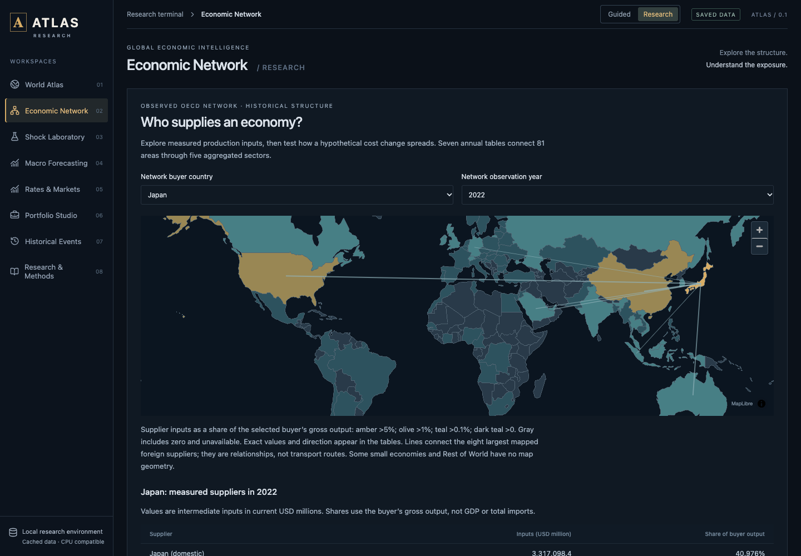
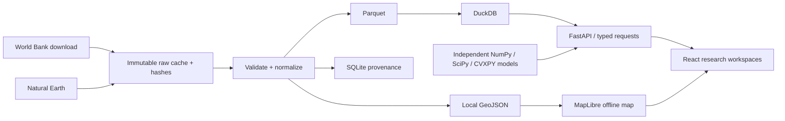

# ATLAS

**A local-first economic research terminal: real country data, production-network scenarios and reproducible PyTorch experiments in one offline app.**

A research terminal, not a product.

Headline result: a ridge baseline beat every PyTorch graph and no-graph model on the one held-out year (2022 test RMSE 14.0001 vs 14.2782 log pp for the best neural run). The GRU forecaster does not consistently beat ridge either.

Warm loopback medians in `docs/LOCAL_LATENCY.json` — one macOS ARM64 machine, ten sequential requests each, not a load test — are 5.31 ms for Japan's network profile, 6.47 ms for 2025 countries, 11.0 ms for a 405-node scenario and 40.51 ms for GRU replay.

[](https://github.com/shmorsi/atlas/actions/workflows/validate.yml) [](https://github.com/shmorsi/atlas/actions/workflows/docker.yml)

[Project overview & screenshots](https://shmorsi.github.io/projects/atlas.html) · [Download release](https://github.com/shmorsi/atlas/releases/tag/v0.1.2) · [Research report](docs/RESEARCH_REPORT.md) · [Validation evidence](docs/VALIDATION.md)


## What's inside


- **Explore:** 177 geographic entities, dated World Bank observations, an offline map, and a guided country-comparison journey.
- **Trace:** seven OECD production tables aggregated to 405 nodes across 81 areas, with documented orientation, independent sample audits and hypothetical cost propagation.
- **Evaluate:** 12 real trained PyTorch checkpoints, all-seed baselines and reproducible inference. The graph experiment has one held-out year; ridge performs best.
- **Inspect:** PyTorch solves and differentiates combined cost scenarios; neural evidence replays real graph checkpoints against held-out observations and baselines. See [Scenario Studio mathematics](docs/SCENARIO_STUDIO.md) and [validation](docs/VALIDATION.md).

This is a **local application**, not a hosted trading service. The **Scenario Studio** implements combined production-cost shocks, assumption comparisons, source attribution and a neural evidence view. The broader ETF/event extension remains [future design work](docs/SCENARIO_STUDIO_RESEARCH.md). The [exact release scope](docs/BUILD_STATUS.md) is documented.

<details><summary>See the OECD network workspace</summary>



</details>

Local-first global economic intelligence and quantitative research terminal. React + TypeScript + Vite + MapLibre + ECharts; Python + FastAPI + DuckDB/Parquet. No hosted services or credentials.

## Quickstart

ATLAS has no authentication. Both paths below serve on 127.0.0.1 only; keep it that way.

### Local release (Node + Python)

Prerequisites: Node 22+, Python 3.12–3.13, a modern WebGL2 browser. On Windows use Python from python.org and run in PowerShell; on macOS/Linux `python3` must refer to a supported Python. Debian and Ubuntu split out the standard-library venv module: if `python3 -m venv` says `ensurepip` is unavailable, install `python3.12-venv` (or `python3.13-venv`) and run setup again. Local browser checks were run on macOS ARM64 / Python 3.12. The [validate workflow](.github/workflows/validate.yml) runs this same setup, the backend tests, the release gate and the production build on Ubuntu, macOS and Windows.

```sh
npm ci
npm run setup
npm run atlas
```

Open http://127.0.0.1:8000. API documentation: http://127.0.0.1:8000/docs. Stop with Ctrl+C. Installation needs internet; normal startup uses bundled data and no external service. The startup command binds only to loopback, verifies source/model integrity, builds production assets, and serves the interface plus API from one FastAPI process. It does not use Vite in production. Set `ATLAS_PORT` to choose another port. For hot-reload development, use `npm run develop` (UI 5173 / API 8000).

The supplied `.venv` and `node_modules` are local conveniences and not part of Git. Install your own dependencies after copying the project. `requirements-lock.txt` records this build's exact Python versions; `package-lock.json` pins JavaScript dependencies. On Linux, setup installs the CPU-only PyTorch wheel pinned in the lock before the other packages — the same wheel the Docker image uses — so a fresh clone does not download the CUDA libraries the application never calls. macOS and Windows wheels from that pin are already CPU builds.

### Docker

```sh
docker build -t atlas .
docker run --rm -p 127.0.0.1:8000:8000 atlas
```

Open http://127.0.0.1:8000. The image runs the same single FastAPI process as `npm run atlas`: a Node stage builds the frontend, and a slim Python 3.12 stage installs `requirements-lock.txt` (CPU PyTorch) and serves the API plus the built UI. The bundled data and checkpoints are copied in from the repository, exactly as the release ships them. The build downloads only npm and Python packages; startup downloads nothing. The release integrity gate (`scripts/check_release.py`) runs during the build and again at startup.

Always publish with the `127.0.0.1:` prefix. The server listens on all interfaces inside the container so Docker can forward the port, and the prefix keeps it reachable from this machine only. To use another host port, change the left side: `-p 127.0.0.1:8001:8000`. The container reports health from `/api/ready`. The [Docker workflow](.github/workflows/docker.yml) builds the image and smoke-tests the API and UI on every pull request.

## Data

177 Natural Earth country/territory geometries and 42,900 WDI records (including missing values), covering GDP, population, growth and trade openness for 1960–2024. Each observation carries entity, unit, period, source, retrieval date, missingness flag and nullable publication/vintage fields. Original release dates are **unknown**. Revised history cannot substantiate a point-in-time backtest.

Natural Earth is public domain. WDI is attributed under World Bank CC BY 4.0 additional terms. See `data/manifest.json` and `docs/DATA_SOURCES.md`. Boundaries are generalized and depict de facto control; small territories may be absent. Country codes use Natural Earth's ADM0 identifiers, with World Bank codes cross-walked explicitly. Trade openness is not bilateral production exposure.

Refresh is explicit, never triggered on startup:

```sh
.venv/bin/python scripts/fetch_data.py
.venv/bin/python scripts/prepare_data.py
```

On Windows replace `.venv/bin/python` with `.venv/Scripts/python.exe`. Raw files are retained and hashed. Normalized observations use Parquet, queried through DuckDB. SQLite stores source metadata and is rebuilt by preparation.

The default atlas additionally includes a separate 2025 WDI cache (660 records, 592 available values). This does not alter the frozen GRU training dataset. Run `npm run refresh:annual` to explicitly update the latest completed annual period; `npm run refresh:public` updates Treasury and official event feeds. The Events workspace provides the same rates/events update action. Retrieval and observation dates are displayed; cached data do not imply real-time coverage.

## Checks

```sh
.venv/bin/python -m pytest -q
npm run build
npx playwright install chromium
npm run verify:release
# With the production app running (macOS/Linux):
ATLAS_TEST_URL=http://127.0.0.1:8000 npm run test:ui
npm run package  # creates ../ATLAS-release.zip and SHA-256 checksum
```

See `docs/BUILD_STATUS.md` for exact completion boundaries and tests; `docs/screenshots/` for inspected layouts. Research workspaces are never filled with invented observations or fake model output.

## Architecture



## Navigation

ATLAS opens in **Guided** mode: choose a country, read plain-language explanations, follow its growth history, and compare two economies. Scroll down in that order. Map gestures leave ordinary page scrolling available; use the zoom buttons or the map's modified gesture. The **What if?** page introduces cost transmission with one slider and a clearly labeled fictional teaching network.

Choose **Research** in the top bar for the full terminal, editable equations, diagnostics, portfolio analysis and saved forecasting experiments. Switching modes preserves the selected country and observation year. Advanced controls remain available without crowding the introductory journey.

See [the finishing plan](docs/FINISHING_PLAN.md) for measurable release criteria and the research/data work still outstanding.


Search countries by name/code, select by map or keyboard-accessible list, change common observation year, choose an indicator and region, and toggle globe/flat projection. Cmd/Ctrl+K focuses search. Escape clears search. Tables offer an accessible alternative to the map. Mobile stacks panels and scrolls wide comparison tables.

## Scientific contract

Observed history, hypothetical input-output effects, bond valuations, and learned predictions have separate result labels. No causal effect, investment performance, or neural improvement is implied without a measured evaluation. Unavailable data and unsupported model links remain explicit. This is research software, not an operational trading system.

## Working research modules

- **Shock / Network laboratories:** user-editable coefficient matrix; synthetic starting example explicitly labeled. Price and quantity solvers, decomposition and numerical diagnostics. A separate Economic Network workspace loads seven real OECD tables aggregated to 405 nodes, with supplier relationships, geographic links and historical cost propagation.
- **Graph research:** six genuine trained PyTorch graph/no-graph checkpoints, three chronological training years, one validation year and one test year. Every seed and baseline is reported; ridge performs best on the one held-out year.
- **Rates:** 694 observed daily Treasury par curves spanning 2024–2026, latest 2026-10-09, with source hash and missingness preserved; hypothetical coupon-bond valuation, duration, convexity and exact yield-shift repricing.
- **Portfolio Studio:** locally uploaded total-return CSV, validated weights, volatility/drawdown/CVaR, minimum-variance/CVaR allocation and chronological holdout comparison. A separate walk-forward mode uses trailing training windows, drifting holdings and costs at every rebalance, with original/equal-weight baselines. No redistributable ETF history is supplied.
- **Macro Forecasting:** real trained compact PyTorch GRU/Gaussian-head experiments, six saved checkpoints, three baselines, ablation, all seeds and held-out diagnostics. On-demand CPU PyTorch inference recomputes predictions from cached, evaluated weights. Small sample and revised-history limitations are explicit.
- **Historical Events:** 30 dated official Fed/ECB releases, filters, source links, explicit refresh, possible transmission channels and annual GDP context. No causal headline-to-market estimate or point-in-time replay.

```sh
.venv/bin/python scripts/train.py
.venv/bin/python scripts/check_notebooks.py
```

See [technical research report](docs/RESEARCH_REPORT.md), [learning guide](learning/README.md), [API contracts](docs/API.md) and [recruiter demo](docs/DEMO_SCRIPT.md). The full original product brief remains only partially fulfilled; the completion matrix is authoritative.

See [release notes and remaining scope](docs/RELEASE.md). The local release package includes production assets, source and real model checkpoints; dependencies still require installation.
