# Inspected screenshot gallery

Generated by Playwright on macOS Chromium, not interface mockups. Recreate with the local app running and `npm run test:ui` on that platform. The reference images in `tests/*-snapshots/` are macOS baselines; other operating systems skip the pixel comparison and do not rewrite this gallery. Update a baseline only after inspecting an intentional change.

## Guided default / desktop

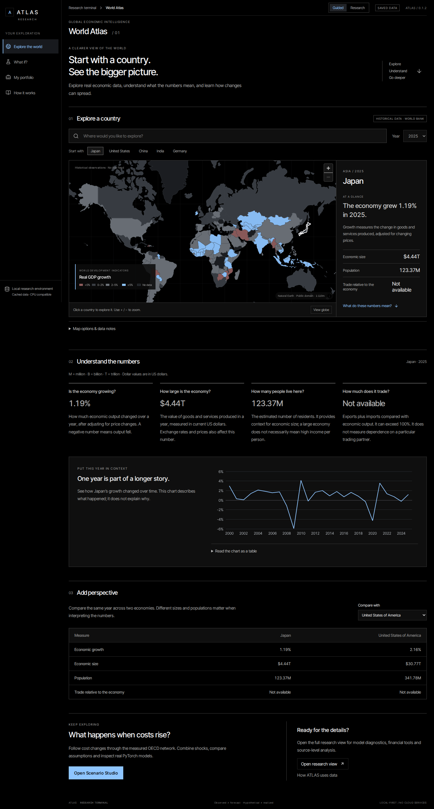

## Guided default / mobile

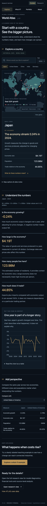

## Guided teaching scenario / mobile

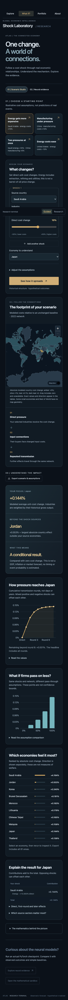

## Research desktop / 1440px

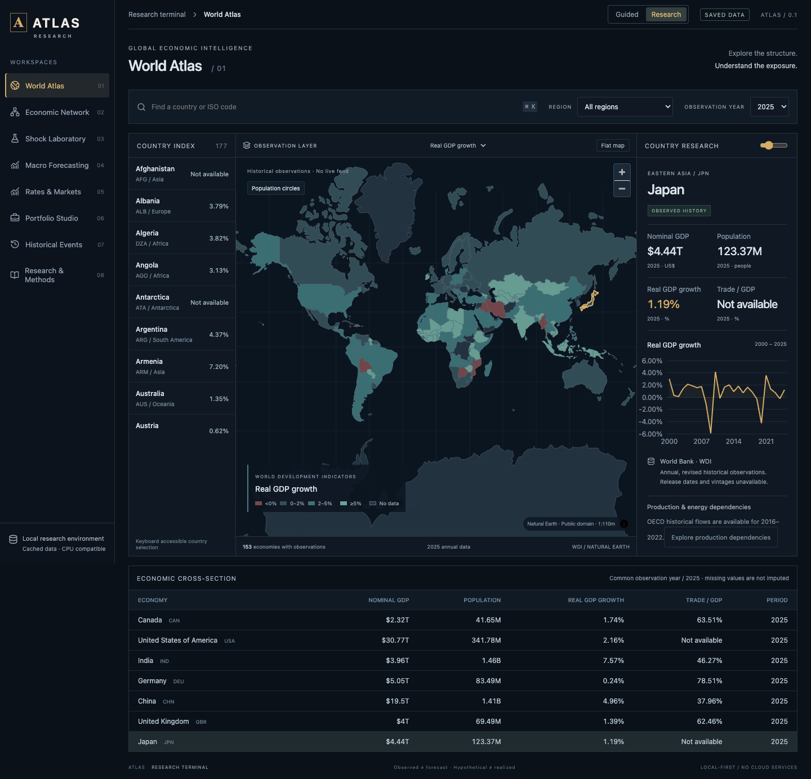

## Wide / 1920px

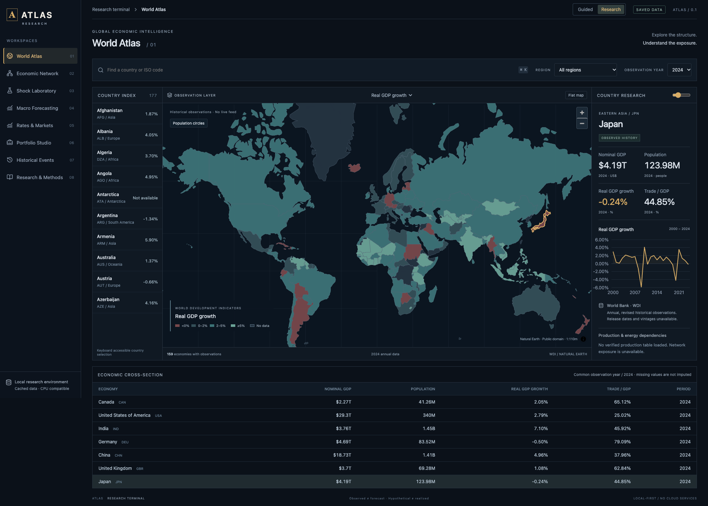

## Tablet / 820px

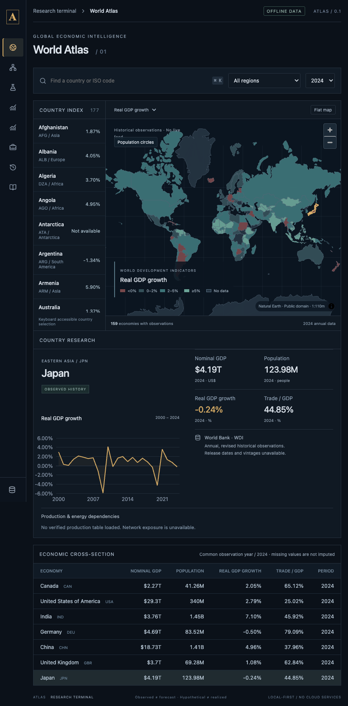

## Mobile / 390px

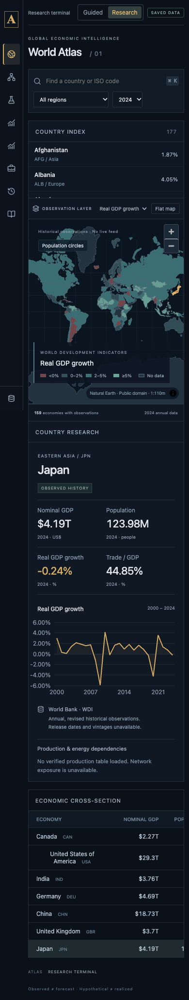

## Hypothetical structural laboratory

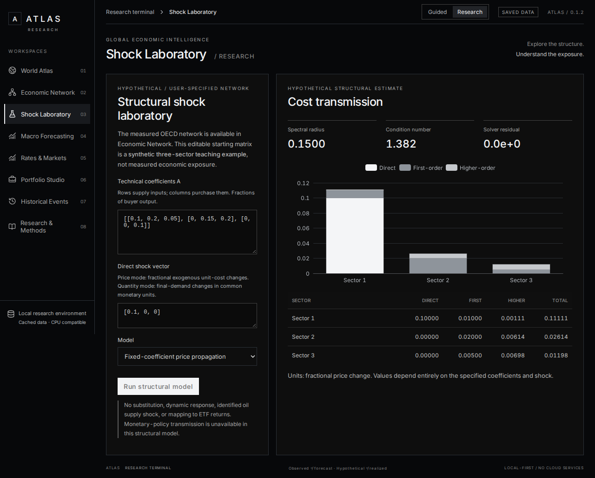

## Actual saved PyTorch evaluation

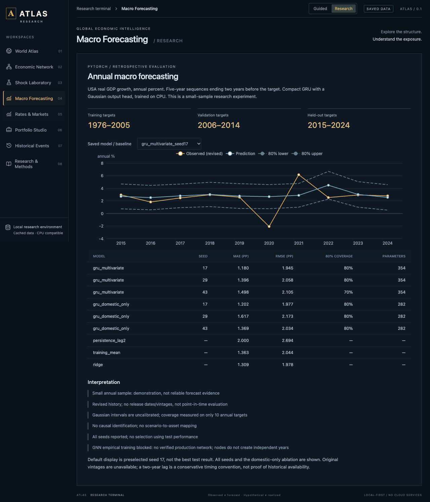

## Observed Treasury curves / production build

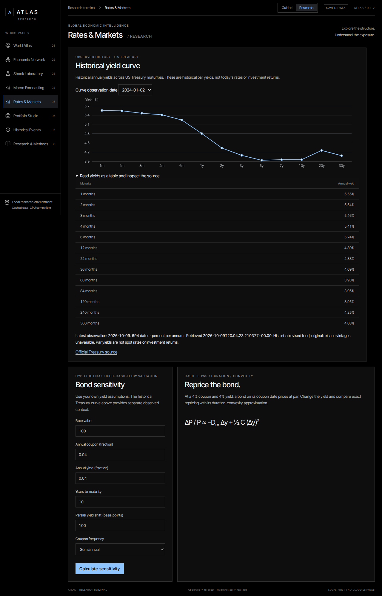

## Scenario Studio

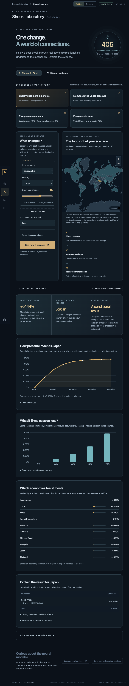

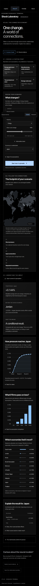

## OECD network

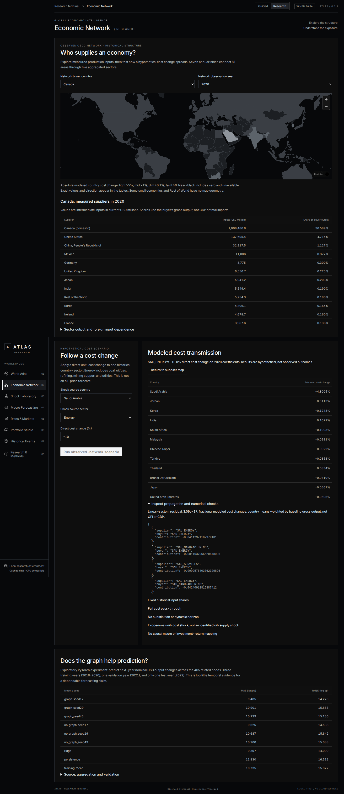

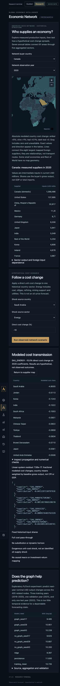

## Official events

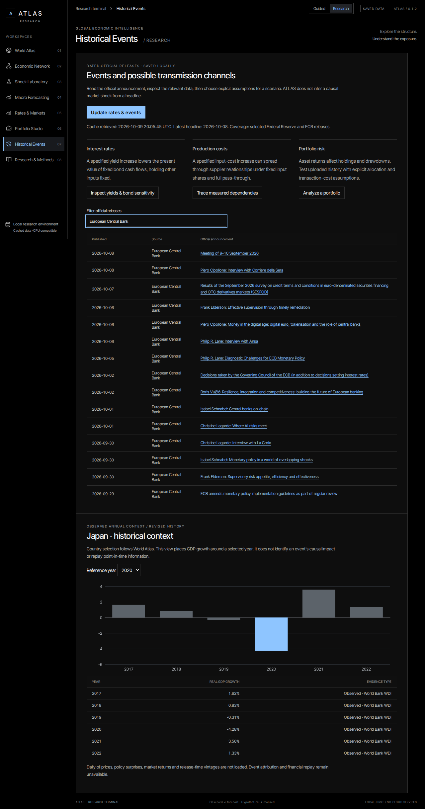

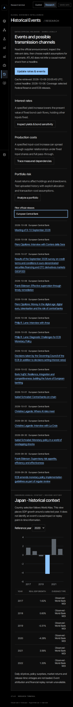

## Guided wide and tablet

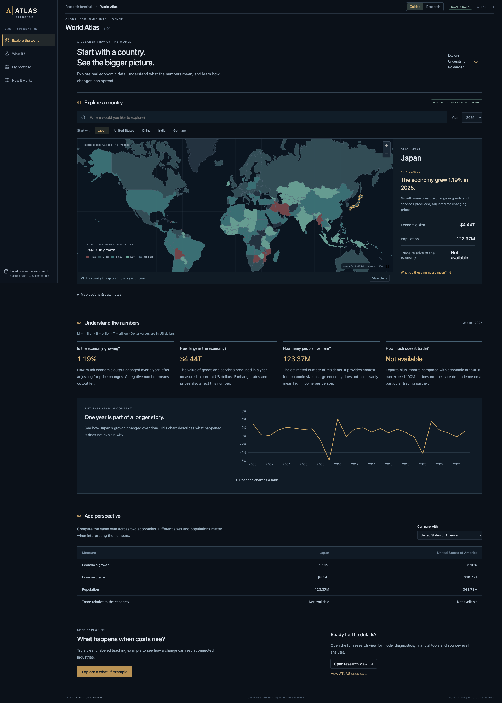

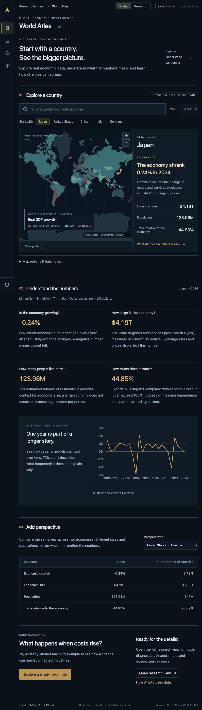

## README figures

`atlas-overview.png` and `atlas-network.png` are the committed images used by the README. The current Playwright paths write the filenames above and do not overwrite those two files.
